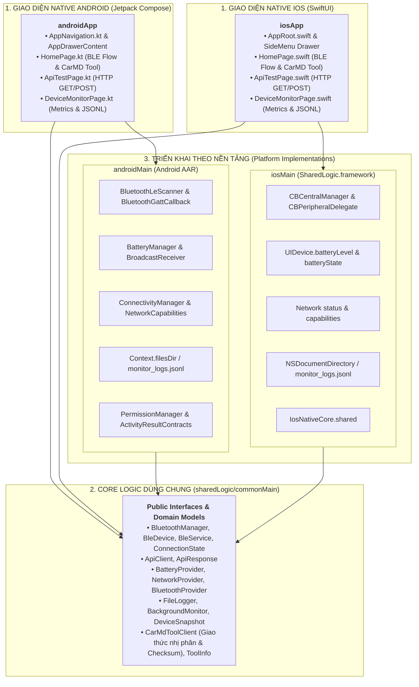

# Tổng quan & Kiến trúc Kotlin Multiplatform (KMP)

Chương trình KMP được xây dựng như một bước phát triển tiếp nối từ lộ trình **Native Mobile Learning Plan**, nhằm đưa các nguyên lý kiến trúc NativeCore sang mô hình **chia sẻ mã nguồn đa nền tảng hiện đại** (Code Sharing) giữa **Android** và **iOS**.

---

## 1. Triết lý KMP: "Share what makes sense"

Khác với các giải pháp Cross-Platform bọc toàn bộ (Hybrid/Webview) hoặc ảo hóa render engine riêng biệt mà bỏ qua native ecosystem:

> **Kotlin Multiplatform theo mô hình Shared Logic Only: Chia sẻ 100% Business Logic, giao thức Bluetooth BLE, HTTP API Client, đo lường phần cứng và định dạng file JSONL trong module `sharedLogic`, trong khi giữ nguyên 100% Giao diện Native gốc (Jetpack Compose trên Android và SwiftUI trên iOS).**



---

## 2. Cấu trúc dự án `demo/kmp`

Dự án thực hành tại `demo/kmp/` phân tách rõ ràng giữa **Shared Logic** và **Native UI**:

| Module | Nhiệm vụ chính | Công nghệ & Thư viện |
| :--- | :--- | :--- |
| `sharedLogic` | Chứa toàn bộ Business Logic, Interfaces, Network, Database/File, Model dữ liệu và Platform bindings | `kotlinx.coroutines`, `kotlinx.serialization`, `ktor-client`, `okio` |
| `androidApp` | Ứng dụng Android Native hoàn chỉnh, sử dụng 100% Jetpack Compose UI ánh xạ 1-1 từ `demo/android/NativeDeviceMonitorDemo` | Android Gradle Plugin (`agp`), `androidx.compose.material3`, `androidx.activity.compose` |
| `iosApp` | Ứng dụng iOS Native hoàn chỉnh, sử dụng 100% SwiftUI UI ánh xạ 1-1 từ `demo/ios/NativeDeviceMonitorDemo`, liên kết `SharedLogic.framework` | Xcode, SwiftUI, Foundation, CoreBluetooth |

::: tip 💡 ĐÃ CÓ MÃ NGUỒN HIỆN THỰC MẪU TRONG DEMO/KMP
Toàn bộ mã nguồn mẫu đối ứng 1-1 với cả hai ứng dụng Native Android và iOS đã được lập trình hoàn chỉnh trong `demo/kmp/`, bao gồm:
- **Shared Logic (`sharedLogic`):** Models, Interfaces, Android & iOS Services, và CarMD Dongle binary protocol client.
- **Native Android UI (`androidApp`):** Jetpack Compose Material 3 Theme, TopBar, Navigation Drawer và 3 màn hình chính (Bluetooth BLE 9 bước, HTTP API Client và Device Monitor).
- **Native iOS UI (`iosApp`):** SwiftUI AppRoot, SideMenu Drawer, AppHeader và 3 màn hình chính liên kết trực tiếp với `SharedLogic.framework`.

👉 Xem chi tiết cấu trúc từng file và hướng dẫn chạy tại: [**Hiện thực Mã nguồn Mẫu (KMP Implementation Guide)**](/kmp/implementation).
:::

---

## 3. Hai kỹ thuật cốt lõi trong KMP

### Kỹ thuật 1: Interface + Dependency Injection (Khuyên dùng cho Service)
Thay vì lạm dụng `expect/actual` ở khắp mọi nơi, các Service điều khiển thiết bị (`BluetoothManager`, `BatteryProvider`, `NetworkProvider`) được định nghĩa dưới dạng **Kotlin Interface** trong `commonMain`.

```kotlin
// sharedLogic/src/commonMain/kotlin/.../BatteryProvider.kt
interface BatteryProvider {
    val batteryLevel: StateFlow<Int>
    val isCharging: StateFlow<Boolean>
    fun startMonitoring()
    fun stopMonitoring()
}
```

- Nền tảng Android triển khai lớp `AndroidBatteryProvider(context: Context) : BatteryProvider` trong `androidMain`.
- Nền tảng iOS triển khai lớp `IosBatteryProvider() : BatteryProvider` trong `iosMain` (sử dụng trực tiếp `platform.UIKit.UIDevice`).
- `commonMain` không hề bị ràng buộc bởi Android `Context` hay Apple UIKit, giúp mã nguồn dễ dàng kiểm thử đơn vị (Unit Test).

### Kỹ thuật 2: `expect` / `actual` (Dùng cho hàm phụ trợ & Factory)
Dành cho các hàm độc lập với ngữ cảnh hoặc các hàm khởi tạo factory:

```kotlin
// commonMain
expect fun getPlatformName(): String

// androidMain
actual fun getPlatformName(): String = "Android ${android.os.Build.VERSION.SDK_INT}"

// iosMain
actual fun getPlatformName(): String = 
    "${platform.UIKit.UIDevice.currentDevice.systemName} ${platform.UIKit.UIDevice.currentDevice.systemVersion}"
```

---

## 4. Trải nghiệm Native trọn vẹn: "Shared Logic, Native UI"

Tại sao dự án lựa chọn mô hình **Shared Logic Only** thay vì cố gắng chia sẻ cả tầng UI?

1. **Giao diện 100% Native (Pixel-Perfect & Human Interface Guidelines):**
   - **Android:** Sử dụng **Jetpack Compose** tiêu chuẩn của Google, tận dụng trọn vẹn Material Design 3, dynamic theme, và tương thích sâu với Android OS lifecycle.
   - **iOS:** Sử dụng **SwiftUI** thuần túy của Apple, giữ vững tính mượt mà 120Hz ProMotion, layout thích ứng Dynamic Island, Safe Area, haptic feedback và các hành vi gesture gốc.
2. **Loại bỏ rủi ro UI Cross-Platform trên iOS:**
   - Tránh các vấn đề thường gặp của các engine vẽ lại UI trên iOS (lệch font, độ nảy cuộn trang không tự nhiên, xử lý bàn phím ảo phức tạp).
   - Đảm bảo ứng dụng iOS vượt qua mọi quy chuẩn kiểm duyệt App Store khắt khe nhất.
3. **Hiệu năng biên dịch LLVM Native tối đa:**
   - Module `sharedLogic` được biên dịch trực tiếp sang **LLVM Machine Code** (`SharedLogic.framework`), cho phép Swift và SwiftUI gọi trực tiếp các Kotlin class/interface/flow mà không qua máy ảo hay bridge trung gian.
4. **Bảo mật & Quyền hệ thống chuẩn mực:**
   - Các quyền Bluetooth (`NSBluetoothAlwaysUsageDescription`), Background Modes (`bluetooth-central`, `fetch`) và Background Tasks vẫn tuân thủ 100% `Info.plist` và `AndroidManifest.xml`.
